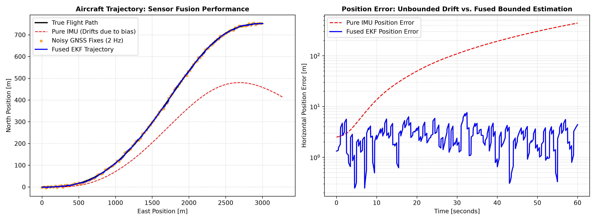

# Loosely Coupled GPS/IMU Sensor Fusion via Extended Kalman Filter (EKF)

A Python simulation of a discrete time Extended Kalman Filter (EKF) fusing high rate (20 Hz) noisy Inertial Measurement Unit (IMU) data with low rate (2 Hz) noisy GNSS position updates during aircraft maneuvers.

This project demonstrates how multi sensor fusion bounds inertial sensor drift, corrects accelerometer bias, and delivers reliable navigation estimates for airborne platforms.

---

## Output Visualization



*Figure: (Left) True vs. Pure Inertial Dead Reckoning vs. Fused EKF trajectory during a coordinated turn. (Right) Logarithmic position error comparison highlighting unbounded IMU integration drift versus bounded EKF estimation.*

---

## Technical Q&A (Systems Engineering Insights)

### Q1: Why does pure IMU dead reckoning diverge so quickly?
Accelerometers measure specific force. Determining position requires **double integration**:
* Any uncorrected DC bias or constant offset (**b**) in the accelerometer creates a quadratic position error over time:
  
  **Error_pos(t) ≈ 0.5 · b · t²**
  
* Over a 60 second flight envelope, an offset as small as 0.15 m/s² compounds into hundreds of meters of drift. In real avionics, this makes unassisted inertial navigation impossible without external absolute corrections.

### Q2: What is the difference between "loosely coupled" and "tightly coupled" GNSS/INS integration?
* **Loosely Coupled (Implemented here):** The GNSS receiver computes its own position and velocity solutions internally using pseudoranges, then feeds those finished coordinates into the central EKF as measurement updates. It is modular and computationally efficient.
* **Tightly Coupled:** The EKF ingests raw GNSS pseudoranges and Doppler carrier phase shifts directly into the state filter alongside IMU data. This allows the system to continue computing updates even if fewer than 4 satellites are visible, but requires significantly higher processing overhead and deeper hardware coupling.

---

## Kinematics & Filter Architecture

### 1. State Vector
The discrete 4-state kinematic vector tracks 2D planar position and velocity:

**X = [pₓ,  pᵧ,  vₓ,  vᵧ]ᵀ**

### 2. State Propagation (Predict Step at 20 Hz)
Driven by measured accelerometer inputs **u = [aₓ, aᵧ]ᵀ**:

**Xₖ = F · Xₖ₋₁ + B · uₖ**

**Pₖ = F · Pₖ₋₁ · Fᵀ + Q**

Where **F** is the state transition matrix, **B** is the control input matrix, **P** is state covariance, and **Q** is process noise covariance.

### 3. Measurement Update (Correct Step at 2 Hz)
When a valid GNSS fix **z = [z_pos_x, z_pos_y]ᵀ** arrives:

**Residual:** **y = z - H · X**

**Kalman Gain:** **K = P · Hᵀ · (H · P · Hᵀ + R)⁻¹**

**State Update:** **X = X + K · y**

**Covariance Update:** **P = (I - K · H) · P**

Where **H** maps the state to position measurements, and **R** is measurement covariance based on GNSS variance.

---

# Applications & Standards

* Aviation Standards: Forms the algorithmic backbone for DO-229 / DO-316 Class Gamma GNSS/INS augmented landing systems.
* Flight Dynamics Utility: Provides continuous state estimates across high-rate maneuvering where GPS update rates alone lag aircraft state changes.

## Full Simulation Code (Python)

Dependencies: `numpy`, `matplotlib`

```python
import numpy as np
import matplotlib.pyplot as plt

# 1. Trajectory Setup
np.random.seed(42)
dt = 0.05
T_total = 60.0
steps = int(T_total / dt)
time = np.linspace(0, T_total, steps)

# True coordinated turn
accel_true_x = 0.5 * np.cos(0.1 * time)
accel_true_y = 1.2 * np.sin(0.1 * time)
vx_true = np.cumsum(accel_true_x) * dt + 50.0
vy_true = np.cumsum(accel_true_y) * dt + 0.0
x_true = np.cumsum(vx_true) * dt
y_true = np.cumsum(vy_true) * dt

# 2. Sensor Models
imu_bias_x, imu_bias_y = 0.15, -0.20
accel_meas_x = accel_true_x + imu_bias_x + np.random.normal(0, 0.25, steps)
accel_meas_y = accel_true_y + imu_bias_y + np.random.normal(0, 0.25, steps)

gnss_rate = 10
gnss_noise_std = 3.5
gnss_meas_x = np.where(np.arange(steps) % gnss_rate == 0, x_true + np.random.normal(0, gnss_noise_std, steps), np.nan)
gnss_meas_y = np.where(np.arange(steps) % gnss_rate == 0, y_true + np.random.normal(0, gnss_noise_std, steps), np.nan)

# 3. Extended Kalman Filter (EKF)
X = np.array([x_true[0], y_true[0], vx_true[0], vy_true[0]])
P = np.eye(4) * 10.0
F = np.array([[1, 0, dt, 0], [0, 1, 0, dt], [0, 0, 1, 0], [0, 0, 0, 1]])
B = np.array([[0.5 * dt**2, 0], [0, 0.5 * dt**2], [dt, 0], [0, dt]])
Q = np.eye(4) * 0.1
R = np.eye(2) * (gnss_noise_std ** 2)
H = np.array([[1, 0, 0, 0], [0, 1, 0, 0]])

x_est, y_est = np.zeros(steps), np.zeros(steps)
pure_dead_reckon_x, pure_dead_reckon_y = np.zeros(steps), np.zeros(steps)
dr_state = np.copy(X)

for k in range(steps):
    u = np.array([accel_meas_x[k], accel_meas_y[k]])
    dr_state = F @ dr_state + B @ u
    pure_dead_reckon_x[k], pure_dead_reckon_y[k] = dr_state[0], dr_state[1]

    # Predict
    X = F @ X + B @ u
    P = F @ P @ F.T + Q

    # Update
    if not np.isnan(gnss_meas_x[k]):
        z = np.array([gnss_meas_x[k], gnss_meas_y[k]])
        y_residual = z - (H @ X)
        S = H @ P @ H.T + R
        K_gain = P @ H.T @ np.linalg.inv(S)
        X = X + K_gain @ y_residual
        P = (np.eye(4) - K_gain @ H) @ P

    x_est[k], y_est[k] = X[0], X[1]

# 4. Visualization
fig, (ax1, ax2) = plt.subplots(1, 2, figsize=(14, 5.2), dpi=150)
ax1.plot(x_true, y_true, 'k-', lw=2, label='True Flight Path')
ax1.plot(pure_dead_reckon_x, pure_dead_reckon_y, 'r--', lw=1.2, label='Pure IMU (Drifts due to bias)')
ax1.scatter(gnss_meas_x[~np.isnan(gnss_meas_x)], gnss_meas_y[~np.isnan(gnss_meas_y)], color='#FF8C00', s=14, alpha=0.7, label='Noisy GNSS Fixes (2 Hz)')
ax1.plot(x_est, y_est, 'b-', lw=1.8, label='Fused EKF Trajectory')
ax1.set_title('Aircraft Trajectory: Sensor Fusion Performance', fontweight='bold', fontsize=11)
ax1.set_xlabel('East Position [m]')
ax1.set_ylabel('North Position [m]')
ax1.grid(True, linestyle=':', alpha=0.6)
ax1.legend(loc='lower left')

error_dr = np.sqrt((x_true - pure_dead_reckon_x)**2 + (y_true - pure_dead_reckon_y)**2)
error_ekf = np.sqrt((x_true - x_est)**2 + (y_true - y_est)**2)
ax2.plot(time, error_dr, 'r--', lw=1.5, label='Pure IMU Position Error')
ax2.plot(time, error_ekf, 'b-', lw=1.8, label='Fused EKF Position Error')
ax2.set_title('Position Error: Unbounded Drift vs. Fused Bounded Estimation', fontweight='bold', fontsize=11)
ax2.set_xlabel('Time [seconds]')
ax2.set_ylabel('Horizontal Position Error [m]')
ax2.set_yscale('log')
ax2.grid(True, which='both', linestyle=':', alpha=0.6)
ax2.legend()
plt.tight_layout()
plt.savefig('ekf_navigation_result.png', dpi=300)
plt.show()

